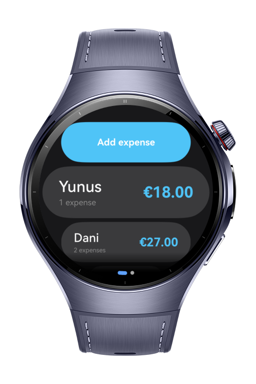
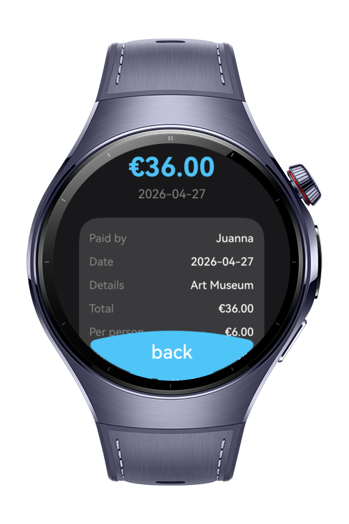

> **Note:** To access all shared projects, get information about environment setup, and view other guides, please visit [Explore-In-HMOS-Wearable Index](https://github.com/Explore-In-HMOS-Wearable/hmos-index).

# Trip Split
Trip split is an wearable application that can split expenses among people. Create trips, add members, log payments, and automatically calculate how much each person paid vs. spent. Supports multiple currencies and generates a clear settlement summary so everyone knows who owes who.
# Preview
<div>
  
  
  
  
</div>

# Use Cases
- creating a trip, setting a name and currency, and adding members
- logging payments by selecting who paid, the amount, and who to split it among
- summarizing trip by showing who owes whom and how much

# Tech Stack
**Languages**: ArkTS, ArkUI
**Libraries/Kits**:
- @kit.BasicServicesKit
- @kit.ArkData
- @kit.ArkUI
- @kit.AbilityKit

# Directory Structure
```
entry/src/main/
├───ets
│   ├───database
│   │   │   AppDatabase.ets
│   │   └───table
│   │           PersonExpenseTable.ets
│   │           RdbTable.ets
│   │           TripAnalysisTable.ets
│   │           TripPersonTable.ets
│   │           TripTable.ets
│   ├───di
│   │       MainRegistry.ets
│   ├───entryability
│   │       EntryAbility.ets
│   ├───entrybackupability
│   │       EntryBackupAbility.ets
│   ├───model
│   │       ExpenseAndPersons.ets
│   │       PersonExpense.ets
│   │       Trip.ets
│   │       TripPerson.ets
│   ├───myabilitystage
│   │       MyAbilityStage.ets
│   ├───pages
│   │       AddExpensePage.ets
│   │       AddTripPage.ets
│   │       ExpenseDetailPage.ets
│   │       Index.ets
│   │       OldTripExpensesPage.ets
│   │       OldTripsPage.ets
│   │       PersonExpensesPage.ets
│   │       TripAnalysisPage.ets
│   │       TripPage.ets
│   ├───registry
│   │       Injectable.ts
│   │       ServiceRegistry.ts
│   │       UIRegistry.ts
│   └───utils
│           Logger.ets
│
└───resources
    └───base
        └───element
                color.json
```

# Constraints and Restrictions
## Supported Devices
- Huawei Watch 5
- DevEco Studio Simulator

# LICENSE
**Trip Split** is distributed under the terms of the **MIT License**.
See the [LICENSE](/LICENSE) for more information.